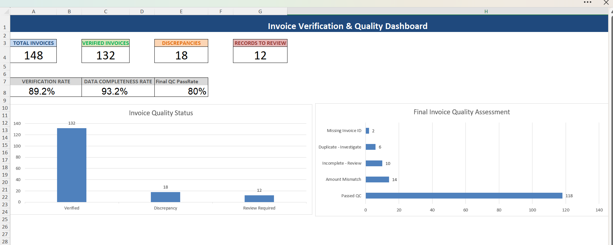
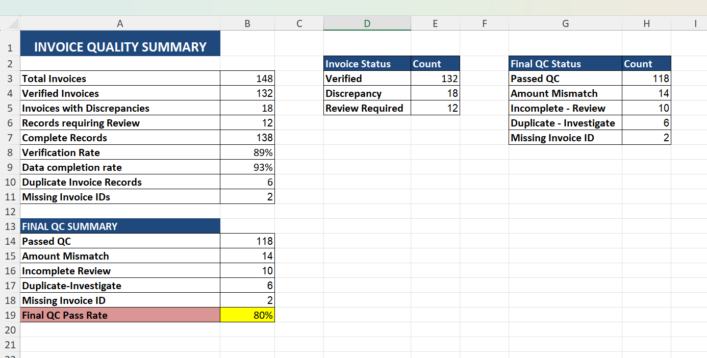

# Invoice Data Verification & Reconciliation Dashboard

## 📌 Project Overview

This project demonstrates how Microsoft Excel can be used to verify invoice data, identify discrepancies, detect duplicate invoice IDs, and monitor data quality.

Using a dataset of 150 invoice records, I developed an invoice verification workflow and an interactive-style dashboard to summarize quality-control results.

The project simulates a business scenario in which data extracted from invoices must be checked for mathematical accuracy, completeness, and consistency before further processing.

## 🎯 Business Problem

Invoice data extracted from documents or AI-powered tools may contain incorrect totals, missing information, invalid quantities, or duplicate invoice IDs.

These issues can affect data reliability and require manual investigation.

The objective of this project is to build an Excel-based quality-control solution that helps identify potential errors and summarizes records requiring further review.

## 🛠️ Tools & Technologies

- Microsoft Excel
- Excel formulas and logical functions
- Excel Tables
- Data filtering and quality checks
- KPI reporting and charts
- Data reconciliation

## 📊 Project Features

### 1. Invoice Calculations
- Calculated invoice subtotals using quantity and unit price.
- Calculated expected tax amounts.
- Calculated expected invoice totals.

### 2. Invoice Reconciliation
- Compared extracted invoice totals against calculated expected totals.
- Calculated the difference between extracted and expected amounts.
- Classified records as verified or discrepant.

### 3. Data Quality Checks
- Flagged missing vendor names and item descriptions.
- Identified non-positive quantities and unit prices.
- Checked invoice IDs for missing values and duplicates.

### 4. Final Quality-Control Classification
Assigned a final QC status to each invoice based on the implemented validation rules.

Possible statuses include:
- Passed QC
- Amount Mismatch
- Incomplete - Review
- Duplicate - Investigate
- Missing Invoice ID

### 5. Dashboard & Reporting
Created a dashboard featuring:
- Total invoice count
- Verified invoice count
- Invoice discrepancies
- Records requiring review
- Verification rate
- Data completeness rate
- Final QC pass rate
- Charts summarizing invoice quality results

## 🧮 Excel Functions Used

| Function | Purpose |
|---|---|
| `IF` | Applied conditional logic and assigned statuses |
| `OR` | Checked multiple data-quality conditions |
| `COUNTIF` | Counted discrepancies, duplicate IDs, and QC categories |
| `IFERROR` | Prevented errors in percentage calculations |
| `COUNTA` | Counted invoice records |
| Arithmetic formulas | Calculated subtotals, taxes, expected totals, and differences |

## 📁 Workbook Structure

The Excel workbook contains three main worksheets:

| Worksheet | Description |
|---|---|
| `Raw_Invoice_Data` | Invoice records, calculated fields, and quality-control checks |
| `QC_Summary` | Summary metrics and chart source data |
| `Invoice_Dashboard` | KPI cards, quality metrics, and visual reporting |

## 📈 Key Learning Outcomes

Through this project, I practised:

- Excel-based data reconciliation
- Data validation and quality-control logic
- Exception identification and investigation
- Duplicate record detection
- KPI calculations and dashboard development
- Translating raw data into actionable quality reports

## ⚠️ Data & Project Limitations

This is a portfolio project using synthetic practice data.

The validation rules are designed for demonstration and do not cover every possible invoice issue. For example, a matching total does not guarantee that the original invoice details are correct.

In a real business workflow, extracted information should also be checked against the original invoice documents, and potential duplicates should be investigated before any financial action is taken.

## 👩‍💻 About This Project

This project is part of my journey toward an entry-level Data Analyst role. It demonstrates my practical application of Microsoft Excel to data verification, reconciliation, data-quality monitoring, and reporting.
## 🖥️ Project Screenshots

### Invoice Quality Dashboard

The dashboard summarizes invoice verification results, discrepancy counts, data completeness, and final quality-control outcomes.

### Invoice Data Quality Checks

The following view illustrates the invoice calculations, reconciliation results, and data-quality checks used to flag records for investigation.

